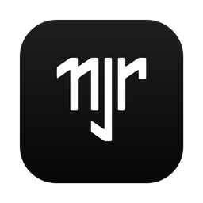

<p align="center">
  
</p>

<h1 align="center">njrNotch</h1>

<p align="center">
  Spotify and Claude Code in your MacBook's notch.
</p>

<p align="center">
  <a href="https://github.com/nikajr10/njrNotch/releases/latest/download/njrNotch.dmg">
    
  </a>
</p>

<p align="center">
  <a href="https://github.com/nikajr10/njrNotch/releases/latest">Release notes</a> ·
  macOS 14.6 or later
</p>

---

## What it does

**Spotify**
- Album art, song and artist, a timeline you can drag, play/pause, next, previous, shuffle and like.
- The accent colour follows the album art and fades when the song changes.
- Click the album art to bring Spotify to the front.

**Claude Code**
- Live state: working, needs permission, done. Allow or deny permission requests right from the notch.
- Context window: total, used and remaining tokens, with a bar that turns amber and red as it fills.
- Your 5-hour and weekly usage limits, with reset times.
- Project, current action, session time, model, effort and a summary of the last result.

**The notch**
- Hover to open. When closed, the sides show album art and an equaliser, or the Claude logo with its state.
- Pop-down notifications for song changes, finished tasks and permission requests.
- Settings inside the notch, a right-click menu, and a keyboard shortcut (⌃⌥N). No menu bar icon needed.

## Install

1. [Download njrNotch.dmg](https://github.com/nikajr10/njrNotch/releases/latest/download/njrNotch.dmg), open it, and drag **njrNotch** into **Applications**.
2. The first time, right-click njrNotch in Applications, choose **Open**, then **Open** again.
   The app isn't notarized by Apple yet, so macOS asks once. You can also allow it in
   System Settings → Privacy & Security.
3. When asked, let njrNotch control **Spotify**. This is how it reads and controls playback; no login needed.

## Set up Claude Code

Open Settings (right-click the notch, or press ⌃⌥N and click the gear), go to **Claude Code**, and install:

- **Hooks**: live state, permission prompts and sounds.
- **Status line**: context window, and 5-hour and weekly limits.

Both back up `~/.claude/settings.json` before changing it. If you already have a status line, it keeps
working exactly as before. Uninstall from the same place to put everything back.

## Privacy

- Everything stays on your Mac. njrNotch talks to Claude Code over `127.0.0.1` only, and refuses requests
  from web pages.
- The like button is optional. It uses your own Spotify app's Client ID (PKCE, no secret), and the sign-in
  token is kept in your Keychain.
- No analytics, no tracking, and no cost or price data anywhere.

## Build from source

Open `njrNotch.xcodeproj` in Xcode and press ⌘R. To make the DMG:

```sh
./scripts/make-dmg.sh    # writes dist/njrNotch.dmg
```

## Uninstall

In Settings → Claude Code, uninstall the hooks and the status line, then quit njrNotch from the
right-click menu and move it from Applications to the Bin.
